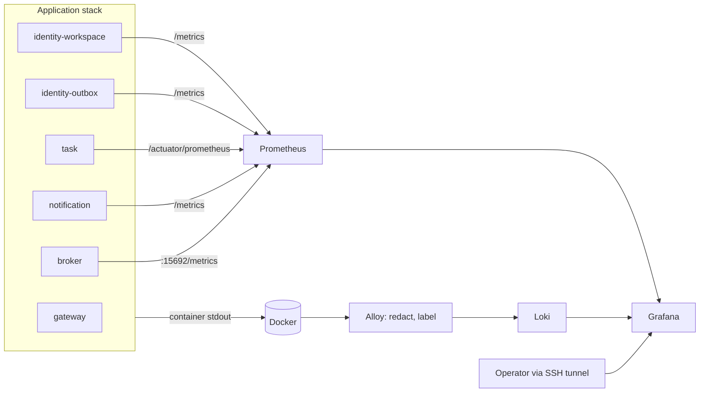

# Centralized logs, metrics and dashboards

Issue #44, part of #3. Configuration lives in [infra/monitoring](../infra/monitoring/README.md); deployment next to the live stack is #34.

## Why

Each service already wrote JSON logs and exposed Prometheus metrics, but nothing collected them. Following one invitation from Identity to a Notification meant reading several containers' logs by hand. This setup collects every component's metrics and logs in one place, shows them on shared dashboards, and lets an operator follow one `request_id` or `event_id` across components.

## Architecture



Prometheus pulls metrics every 15 seconds and evaluates the alert rules. Alloy reads container logs from the Docker socket, removes secrets and sends them to Loki. Grafana reads both. Only `127.0.0.1` ports are published.

## Who owns what

| Area | Owner |
| --- | --- |
| Metrics and log content of each service | That service (Identity, Task, Notification). Infrastructure for the gateway and broker. |
| Collection, alert and dashboard definitions in `infra/monitoring/` | Notification work area (#44) |
| Running the monitoring stack locally and in the cloud, access and backups | Gateway & Infrastructure (#34) |

## Log fields

Every component writes one JSON object per line to stdout. The shared fields are:

| Field | Meaning | Identity | Task | Notification | Gateway |
| --- | --- | --- | --- | --- | --- |
| time | UTC timestamp | `timestamp` | `@timestamp` | `timestamp` | `time` |
| level | severity | `level` (`INFO`, `WARNING`, `ERROR`) | `log.level` | `level` (`info`, `warn`, `error`) | none (use `status`) |
| event | what happened | `event` | `message` | `event` | none |
| request_id | correlation UUID from `X-Request-ID` | yes | yes (MDC) | yes | yes |
| event_id | domain event UUID | outbox logs | inside `message` (`event_id=...`) | consumer logs | no |

Alloy normalises the severity into a `level` label (`info`, `warn`, `error`) and copies `request_id` and `event_id` into Loki structured metadata, whichever format a component uses. Labels stay low-cardinality: `service`, `stack`, `level`.

Never logged anywhere: bearer tokens, Google tokens, service keys, broker or database passwords, message bodies, task titles, comment text and email lookups. Each service enforces this with an allowlist. Alloy then redacts bearer tokens, URL passwords and `password`/`secret`/`token`/`service_key` values as a second safety net.

## Metrics used by the dashboards

| Signal | Metric |
| --- | --- |
| Availability | `up` for each job; `identity_readiness_status` |
| Request rate and 5xx | `identity_http_requests_total`, `http_server_requests_seconds_count` (Task), `notification_http_requests_total`, `notification_http_server_errors_total`; gateway access log |
| Latency | `identity_http_request_duration_seconds` and `notification_http_request_duration_seconds` histograms (p95); Task average from `http_server_requests_seconds_sum/_count`; gateway `request_time` from logs |
| Upstream errors | gateway access log `upstream_status` |
| Pending outbox count and age | `identity_outbox_pending`, `identity_outbox_oldest_pending_age_seconds`, `task_outbox_pending`, `task_outbox_oldest_seconds` |
| Publication failures | `identity_outbox_publish_failures_total`, `task_outbox_publish_failures_total` |
| Consumer outcomes, duplicates, retries, failures | `notification_consumer_*`, `task_cleanup_*` |
| Dead-letter depth | `rabbitmq_queue_messages{queue=~".+\.dlq"}` |
| Cleanup lag | `rabbitmq_queue_messages` for `task-cleanup.v1` and its retry queues |

## Dashboards

- **Service health:** which endpoints are up, Identity readiness, request rate, 5xx rate, p95 and average latency, gateway upstream errors and the latest failing gateway requests.
- **Event pipeline:** pending outbox events and their age (line at 5 minutes), publication failures, consumer outcomes, failures, retries and dead letters, dead-letter queue depth, main queue depth and cleanup lag.
- **Trace an ID:** paste a `request_id` or `event_id` to see which components logged it and every matching line, oldest first.

## Alerts

The indicators below are proposed thresholds, to be confirmed with Gateway & Infrastructure. The outbox age of 5 minutes comes from the event contract.

| Alert | Condition | Why it matters |
| --- | --- | --- |
| `OutboxBacklogOld` | oldest pending outbox event older than 300 s for 1 minute | Events are not reaching the broker; notifications and cleanup are delayed |
| `OutboxPublishFailing` | publish failures for 5 minutes | Broker credentials, routes or connectivity are broken |
| `DeadLettersWaiting` | any `.dlq` holds a message for 1 minute | An event needs an operator to investigate and replay |
| `ConsumerFailuresPersisting` | more than 5 processing failures in 10 minutes | A consumer's database or dependency is failing |
| `CleanupLagHigh` | more than 50 cleanup events waiting for 10 minutes | Removed members may keep assignments for longer than expected |
| `ServiceDown` | metrics endpoint unreachable for 2 minutes | A component is down or unreachable |
| `IdentityNotReady` | Identity readiness reports database down for 2 minutes | Sign-in and every protected request fail |
| `HighServerErrorRate` | more than 5% of requests return 5xx for 5 minutes | Users see failures |

## How to investigate a failure

1. Start from an alert or a red panel in **Service health** or **Event pipeline**.
2. Get an ID. For a request, use the `X-Request-ID` response header or the gateway's failing-request panel. For an event, use the `event_id` in an `event_retry_scheduled` or `event_dead_lettered` log line.
3. Paste it into **Trace an ID**. The bar chart shows which components saw it; the log panel shows the order of events, for example gateway → task → task outbox → notification retry → notification processed.
4. Fix the cause. For dead letters, replay with `infra/broker/scripts/replay_dead_letters.py`; deduplication keeps the replay safe.

## Verification with sample telemetry

Run on 2026-11-27 with `infra/monitoring/scripts/verify.sh` (sample telemetry only, label `stack="sample"`). Result: 21 of 21 checks passed.

- Loki became ready, and all five scrape targets were up.
- Identity readiness, outbox age, Task outbox age, Notification consumer and latency histogram, and dead-letter depth metrics were present.
- `OutboxBacklogOld` and `DeadLettersWaiting` were raised from the sample values.
- One `request_id` was found in gateway, identity-workspace, task and notification logs.
- One `event_id` was found as structured metadata in task and notification logs.
- The `level` label held only `error`, `info` and `warn`.
- A probe line containing a bearer token and an `amqp://` password was stored with `[REDACTED]`, and neither secret was found in Loki.
- Both Grafana data sources were healthy, all three dashboards were provisioned, and anonymous access was refused with 401.

Also checked: `promtool check config`, `promtool test rules` (5 alert cases), `loki -verify-config` and `alloy fmt`.

## Live verification

Run on 2026-11-28 against the real local stack (`infra/compose.yaml`, including Notification since #77) with monitoring attached through `infra/monitoring/compose.stack.yaml`. No sample telemetry was running.

### Healthy system

- All five scrape targets were `UP`: `identity-workspace`, `identity-outbox`, `task`, `notification` and `broker`.
- Both Grafana data sources were healthy and all three dashboards loaded. Loki held real logs from the gateway, Identity and Notification.
- 60 requests through the gateway and the events from `infra/scripts/check-events.sh` appeared in **Service health** (request rate, latency, no 5xx) and **Event pipeline** (Notification `created`, outboxes at 0, dead-letter queues at 0).

### Deliberate failure: Notification's database stopped

```sh
docker compose -f infra/compose.yaml stop notification-db    # 12:24
bash infra/scripts/check-events.sh                           # publishes three notification events
docker compose -f infra/compose.yaml start notification-db   # 12:29:30
```

While the database was down, Notification stayed live (`/health/live` 200) and reported itself not ready (`/health/ready` 503). The **Trace an ID** dashboard followed the assignment event `8e222df1-2c6e-4c53-b7e2-5e660b0aee56` from producer to consumer:

| Time | Service | Log |
| --- | --- | --- |
| 12:25:12 | task | `Published event_id=8e222df1… type=task.assigned.v1` |
| 12:25:14 | notification | `event_retry_scheduled` attempt 1, delay 5s |
| 12:25:20 | notification | `event_retry_scheduled` attempt 2, delay 30s |
| 12:25:52 | notification | `event_retry_scheduled` attempt 3, delay 2m |
| 12:27:53 | notification | `event_retry_scheduled` attempt 4, delay 10m |
| 12:37:53 | notification | `event_processed` attempt 5, outcome `created` |

The invitation and mention events followed the same path and were processed at 12:37:52 and 12:37:55.

- **Metrics:** Notification processing failures and retries rose to 12 each (3 events × 4 attempts). `notifications.v1.dlq` stayed at 0, so no event was lost or dead-lettered.
- **Alert:** `ConsumerFailuresPersisting` (service `notification`) was pending from 12:25:41, firing from 12:30:41, and cleared at 12:35:41 after the failures stopped.
- **Recovery:** after the database returned, the next scheduled retry succeeded without operator action. Each event produced exactly one stored notification.

## Gaps

- **Gateway metrics.** The gateway has no metrics endpoint (planned in #34). Its rate, latency and upstream errors come from the access log instead.
- **Task latency percentiles.** Task exports no histogram buckets, so only its average latency is shown. Setting `management.metrics.distribution.percentiles-histogram.http.server.requests=true` in Task would enable p95.
- **Alert delivery.** Alerts are evaluated and visible in Prometheus, but no Alertmanager or destination (email, chat) is chosen.
- **Identity readiness panel.** Identity updates its readiness gauge only when `/health/ready` is called, and nothing in the stack calls it on a schedule. After a restart the panel shows `UNKNOWN` until a probe runs. A periodic readiness probe (for example from the deployment's health checks) would keep it current.
- **Cloud deployment.** The live check used the local stack. Repeating it on the deployed system belongs to #34.
- **Backups of monitoring data** are not covered; logs and metrics are kept for 7 and 15 days.
